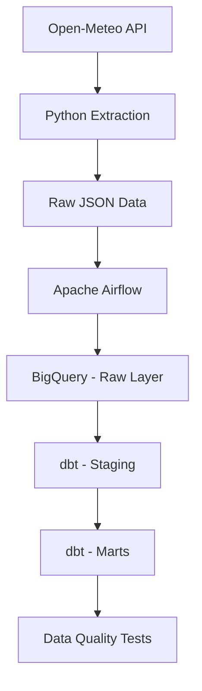

# Weather Data Pipeline ☁️

An end-to-end data engineering project that collects weather data from an API, orchestrates data processing with Apache Airflow, stores raw data in Google BigQuery, and transforms it into analytical models using dbt.

## Architecture 📐



## Technologies 💻

- **Python** — API integration and data processing.
- **Apache Airflow** — Pipeline orchestration.
- **Docker** — Containerized execution environment.
- **Google BigQuery** — Cloud data warehouse.
- **dbt Core** — SQL transformations, data modeling, and testing.
- **pytest** — Python unit testing.
- **Open-Meteo API** — Weather data source.

## Project Overview 🔎

The pipeline collects weather observations from the Open-Meteo API for Florianópolis, Brazil, and processes them through an automated, orchestrated workflow.

The project was designed to practice core data engineering concepts, including API integration, workflow orchestration, cloud data warehousing, analytical data modeling, and data quality validation.

## Data Workflow ⚙️

1. **Extract:** Python retrieves weather observations from the Open-Meteo API.
2. **Load:** The extracted data is stored in Google BigQuery's raw layer.
3. **Transform:** dbt processes the raw data into staging and analytical models.
4. **Validate:** Data quality tests check required fields and help identify incomplete records.

Apache Airflow orchestrates the workflow, coordinating the extraction, loading, and transformation tasks.

## Data Modeling 🛠️

The project follows a layered approach to data modeling.

| Layer         | Description                                                     |
| ------------- | --------------------------------------------------------------- |
| `weather_raw` | Stores the original weather observations loaded into BigQuery.  |
| `staging`     | Organizes and prepares raw data for downstream transformations. |
| `marts`       | Provides an analytical model for weather observations.          |

### dbt Models

- **`stg_weather_observations`** — Selects and prepares data from the raw BigQuery table.
- **`fct_weather_observations`** — Builds the analytical model and derives the observation date in the `America/Sao_Paulo` timezone.

## Data Quality 💎

Data quality is addressed at different stages of the pipeline:

- Python unit tests using `pytest`.
- dbt tests to validate required fields, including timestamps, coordinates, temperature, and relative humidity.
- dbt build execution to run transformations and associated tests.

## Project Structure 🧩

```text

weather-data-pipeline/
├── dags/
│   └── weather_pipeline.py
├── data/
│   └── raw/
│       └── .gitkeep
├── dbt_project/
│   ├── models/
│   │   ├── staging/
│   │   │   ├── stg_weather_observations.sql
│   │   │   └── stg_weather_observations.yml
│   │   └── marts/
│   │       ├── fct_weather_observations.sql
│   │       └── fct_weather_observations.yml
│   └── dbt_project.yml
├── src/
│   ├── extract_weather.py
│   └── load_weather.py
├── tests/
│   ├── test_extract_weather.py
│   └── test_load_weather.py
├── .env.example
├── .gitignore
├── docker-compose.yaml
├── Dockerfile
├── requirements.txt
└── README.md
```

## Getting Started 🚀

### Prerequisites

- Docker Desktop with WSL 2 integration.
- A Google Cloud project with the BigQuery API enabled.
- Google Cloud credentials configured for Application Default Credentials.
- A BigQuery dataset for raw data.
- A dbt profile configured for BigQuery.

### Setup

1. Clone the repository:

   ```bash
   git clone https://github.com/furtluc/weather-pipeline-dbt-bigquery.git
   cd weather-pipeline-dbt-bigquery
   ```

2. Configure environment variables: Copy .env.example to .env and adjust the values if necessary.

3. Configure the dbt BigQuery profile in `~/.dbt/profiles.yml`, ensuring the project ID, dataset, authentication method, and location match your Google Cloud environment.

4. Build the Docker image and start the services:

   ```bash
   docker compose build
   docker compose up -d
   ```

5. Access the Airflow interface at [http://localhost:8080](http://localhost:8080).

6. Trigger the `weather_pipeline` DAG manually and monitor the task execution.

> **Note:** The DAG is currently configured for manual execution. The pipeline requires a valid Google Cloud configuration and the appropriate BigQuery resources before it can run successfully.

## Future Improvements 📈

- Implement incremental loading and deduplication to make repeated executions idempotent.
- Add automated scheduling.
- Expand the analytical models and historical weather analysis.
- Improve monitoring, logging, and failure notifications.
- Add more comprehensive tests and documentation.

## Author 👤

**Lucas Furtado**

- GitHub: [@furtluc](https://github.com/furtluc)